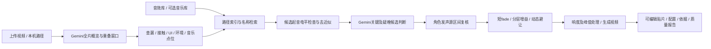

# ⑥版复盘与标准流程配置

本复盘依据本地⑥版现存清单、源剪辑/选材/混音/用量报告及实际渲染代码。历史文件保持原样；新流程用独立版本号固定方法，视频点位和素材由新输入决定。

## 已确认的⑥版

| 项目 | 实际内容 |
| --- | --- |
| 参照任务 | `0bb00d13-d84e-4812-9eca-9ed78b79bef9` |
| 输入 | `E:\Reaper\Aud\Boss大招+玩家蓄力.mp4`，25.9秒 |
| 素材库 | `E:\M98\整理版`，约113274份路径索引 |
| 点位 | 67个事件，85个启用贴片；继承⑤版点位与选材 |
| 模型 | 工具请求/报告`gemini-4-argon`；实际网关返回名另看usage，不据别名断言底层厂商版本 |
| 视觉流程 | `overview-window-audit-dense-contact-music-v3`，5个重叠主窗口，21个接触复核；查漏10个12FPS短窗口 |
| 选材依据 | 继承选材报告：20份音频片段、10层选用、0回退；历史selectionScope未保存，不能补写为新标准selective |
| 角色吼叫 | 同一库素材`吼叫 [vo_apesstonehand_roar] [69592975.wem].wav`；8.8秒点位取源.020–.820秒，12.8秒点位取.850–2.280秒 |
| 吼叫处理 | Gemini新听源片段，选择一个主体与短释放，不播放整份多次吼叫录音；短淡入淡出；无变速变调 |
| 空间处理 | **没有额外混响**；保留素材自身空间尾音，另有增益、平滑避让、淡入淡出、响度与峰值处理 |
| 原视频声 | 历史版−60dB近似静音；新标准改为数字静音 |
| 音量 | 目标−20LUFS/−1.5dBTP；⑥实测−20.03LUFS/−3.16dBTP |
| 备选 | 423个已测候选条目/85层，含338个额外备选；当次近似配对检查通过，不等于人听感全部合适 |
| ⑥当次开销 | 258904ms，1次新源音频剪辑请求，818输入/344输出token；不含继承的点位/选材成本，不能作为完整生成成本 |

## 新视频固定执行的流程

名称从点位语义检索并打分。`cast/施法`、`charge/蓄力`、`start/end`、角色和材质作为匹配依据；名称疑点可以被真实听音依据纠正，不设绝对词禁用。

备选合并同录音编号变体并比声学近似；先保证符合动作，再追求不同听感。数量不足少给，不能以相似变体或不相关声音凑五份。

点位必须Gemini；选材采用本地规则+Gemini关键/疑难复核，非全库/全量听音。声音制作和渲染使用本地文件；Gemini不生成新音频。

## 运行参数

唯一维护位置：`src/sfx/WorkflowPolicy.ts`。`GET /api/sfx/workflow` 返回当前完整配置，每次新建任务保留配置快照，避免文档值与实际执行漂移。

本轮验证的非敏感连接快照（2026-11-16）：只读`C:\Users\jiangxy2\.codex\config.toml`的custom provider，地址`http://127.0.0.1:15721/v1`，协议`responses`，服务端有鉴权。公司上游由本地网关转发；这里的可确认API地址是本机网关，不能据官网域名推定上游请求地址。工作台端口4320，模型请求/响应均记录`gemini-4-argon`。FFmpeg/FFprobe为本机WinGet安装的8.1.1版本。凭据不进入该文档或技能包；配置路径可由工具专用`SFX_CCSWITCH_CONFIG`覆盖。

| 阶段 | reference-v6 / 1.0.6 |
| --- | --- |
| 模型连接 | CC Switch本地活动配置的地址/鉴权，只读；工具固定请求`gemini-4-argon`，不写全局模型 |
| 画面采样 | 主窗口6秒/步进5.6秒、5FPS；查漏3秒/步进2.8秒、12FPS；接触复核30FPS；当前最大视频300秒 |
| 候选 | 每层检索40，最多测8个不同家族，返回最多5个不同备选；只解码候选 |
| 目录偏好 | 总库权重1；可加12个优先路径，权重1–10，默认3。相关性先于有界路径加分，重叠取max；外部目录懒索引去重。Gemini接收偏好，不以目录压过真实声音匹配；不影响音量 |
| 声学近似 | 时长比>.8、频带相似>.985、包络相似>.965、重心差<220Hz结合判断，另有名称家族合并 |
| 音频复核 | selective：所有关键点位及最多12个普通疑难事件；最多160份样本；音效最多6秒，音乐最多24秒候选片段 |
| 发声剪辑 | 本地提案释放最多.35秒；Gemini区间最多动作+.5秒、主体后释放最多.4秒；须落在真实样本和素材/视频边界内 |
| 移动剪辑 | 本地收势释放最多.18秒；瞬态保留自然尾音；完整长文件不能代替段落判断 |
| 裁剪边缘 | 默认5ms淡入/80ms淡出，短片段按长度约束；锁定人工编辑保留 |
| RMS层级 | 音乐−37+4×强度；环境−40；细节−36；角色−23；预警−22；主动作−23；蓄力−28；UI−32；运动−29；拟音−34dB，再结合源电平限制增益 |
| 画面距离 | Gemini逐点给near/mid/far/unknown、独立置信度及可见依据；低于.65或无依据则中性。实际发声位置优先，近处落点不继承远处Boss距离；UI/音乐/环境底床豁免 |
| 远近与主次 | 近/中/远基准0/−4/−10dB；key/support/detail衰减倍率.8/1/1.2。吼叫、预警、蓄力保可读性，普通脚步/碎屑及次层降低；距离减益在源峰值限增益后执行并记录，保存预览不重复扣减 |
| 避让 | 音乐/环境/细节最低线性增益.36/.5/.56；attack.08、hold.12、release.5秒，合并前景窗口 |
| 主输出 | 近景基准−20LUFS/−1.5dBTP，limiter.84；含可靠距离的清单以去减益参考能量计算距离余量，线性总线保留远景较轻。无距离历史清单保留两遍响度流程；保存有效目标、实际处理及实测 |
| 主线密度 | Boss大型接触主体优先，最多一个有明确材质意义的次层；连续动作保留各接触点但不重复叠加texture/tail；前景峰值并发>6时报告needs-review，先减装饰层再调电平 |
| 音色/空间 | 原速原调，无额外混响，数字静音原视频音轨 |
| 输出格式 | 48kHz/24bit立体声WAV；H.264/AAC预览；JSON/CSV可编辑清单 |

## 验收与异常处理

- 画面模型失败：任务失败并指出连接原因，不能自动降级镜头检测冒充动作识别。
- 候选或源音频模型失败：保留有界规则结果、短fade和已做决定，报告partial/fallback；不把试听确认说成已经完成。
- 没有合适素材：保留点位和缺口，允许手动检索替换；尤其音乐/吼叫/蓄力不能随意消失或用啾声顶替。
- `workflow-report`记录阶段完成/复用、素材来源、区间、fade、差异、已列动作覆盖、音乐/环境缺口、发声判断、实测响度、预览清单版本。客观通过仍须试听验收。
- 修改后重新生成；锁定贴片保留人工设置。重新选材/混音生成新任务，历史对照保持可播放。
- `usage-report`记录本次阶段时长、请求模型/返回模型与token。旧点位、选材、音频缓存不重复收费统计；缺失usage明确标记。

## 交付与接口

工作台`/sfx`固定执行标准流程，只保留视频、音效目录、可选音乐目录及项目名称输入。模型、音乐分析、选材范围和保留版复用均自动执行，不提供模式开关。生成后的结果可逐点编辑，以effective和revision为准。

2026-11-20交互更新：所有人工修改、素材替换、静音、恢复和删除先暂存，不触发保存或渲染；点击“更新视频预览”才统一提交并生成子版本。刷新/切换可恢复绑定原修订的本机草稿，撤销暂存不渲染；更新失败保留旧预览和草稿。导出不会暗中应用暂存修改，REAPER工程名自动补`.rpp`。下列1.0.3及同日补充的自动更新交互为历史记录，现由本段取代，音效选择和混音配置不因此改变。

配置1.0.1起，已认可的成片与方法参数分开保存。点“保留本版音效”后，同视频内容、同音效/音乐目录的提交默认打开原run，路径不同的上传副本也可复用。若保留的版本后来被修改或文件缺失，显示原因，不能悄悄重新选材。普通预览保留现存混音/区间；纯混音仅调整电平和避让。新视频仍执行完整Gemini流程。⑦的新选材曾把持续蓄力换成带脆裂的多脉冲录音，用户未认可，因此不得以⑦代替⑥。

1.0.2修正了保留机制的执行缺口：编辑已保留run自动另存副本，原run与媒体不写回；搜索只读；同一已选素材不可重复选用来触发重裁。纯混音和保存预览精确保留有效源区间及fade，不因元数据补测改变。选材请求补齐事件/层声音意图，并将持续蓄力与脉冲声的描述冲突标待试听，名称仍为参考。新视频模型效果没有在本次修正中重新付费生成验证，不能用自动测试代替听感验收。

1.0.3将界面固定为上述流程；点位和各层音效增加直接静音、恢复、删除，自动保存独立子版本并生成/显示预览。整点位静音不改层enabled，恢复不会误开原本单独关闭的音效。删除后不自动补选，全部删除仍能渲染静音视频。其他手工编辑合并为“保存并更新预览”。已有预览画面直接复用编码，不额外调用模型；保留源区间、fade和gain，重新混合实际启用音频。生成需要本地处理时间，完成后自动定位到操作前播放位置。原版通过返回修改前版本或历史项目回看。

1.0.4根据猩猩Boss人工贴片参考补充主线密度约束：大型Boss接触以主体冲击为首选，最多增加一个有画面依据的材质次层；连续接触仍分别保留点位，但相邻动作不重复叠加texture/tail。混音报告在前景峰值并发超过6层时标记待复核，先减少装饰层再调整电平，避免用整体压低主线来掩盖拥挤。

1.0.5把声源距离和声音主次接到Gemini已有点位请求、接触复核、自动混音和清单。相对画面只分近中远，不推算米数；远处怪物动作较轻，关键主体仍高于细碎声，近处落点独立判断。已保存贴片记录实际距离减益；普通编辑/预览不重复衰减、不重新判断。总线保留距离能量余量，避免归一化把全远景拉回近景。历史认可版本保留原文件、素材、剪辑和听感，不补写虚构空间依据。

同日界面补充：工作台不展示技能包/文档/下载入口；选用其他候选自动保存并生成子版本预览，无需再点保存。换用层按素材规划短淡入淡出，其他层保持原样。失败保留待保存修改和旧视频，状态注明预览未更新。上述交互不改变1.0.4的模型与混音配置。

| 接口 | 用途 |
| --- | --- |
| `GET /api/sfx/workflow` | 配置、阶段、四个skill的链接 |
| `GET /api/sfx/workflow/guide` | 本文 |
| `GET /api/sfx/workflow/bundle` | 包含四个skill、runner和配置的ZIP，无凭据 |
| `POST /api/sfx/runs` | `{videoPath,libraryPath,musicLibraryPath?,workflowPreset:"reference-v6",name?,reusePreserved?:true}`；默认优先保留版 |
| `POST /api/sfx/runs/:id/preserve` | `{revision}`；保留当前已渲染版本，作为同视频和素材库的默认选择 |
| `POST /api/sfx/runs/:id/quick-edit` | 兼容API：`{revision,target:"event"或"placement",targetId,action:"mute"或"unmute"或"delete"}`；仍自动另存并渲染，当前网页不调用 |
| `POST /api/sfx/runs/:id/edit-preview` | `{revision,events,placements,originalGainDb,originalMuted?,musicEnabled?,keywordPreferences?}`；网页仅在点击“更新视频预览”后提交，保存手工编辑副本并渲染 |
| `GET /api/sfx/runs/:id/status` | 紧凑轮询 |
| `GET /api/sfx/runs/:id/export/workflow` | 实际配置/质量报告；旧版本按现存证据只读重建 |
| `GET /api/sfx/runs/:id/export/video` | 带音效预览视频 |
| `GET /api/sfx/runs/:id/export/json` | 贴片和源文件区间 |
| `GET /api/sfx/runs/:id/export/usage` | 本次耗时/请求/token |

服务进程需在正常Windows权限下能运行FFmpeg和访问本机目录；若出现spawn EPERM，先诊断进程权限，不重复全库扫描。上传视频是拷贝到本地工作区，指定音效库路径直接读取，默认无需上传整个库。

1.0.6加入页面内本机目录浏览，消除SFX目录选择对分离PowerShell窗口及无限轮询的依赖；选择/取消均返回工作台。素材路径权重进入索引检索、Gemini候选依据、任务持久化、导出和保留版本身份。普通编辑/预览不因新增权重功能更换既有声音。
