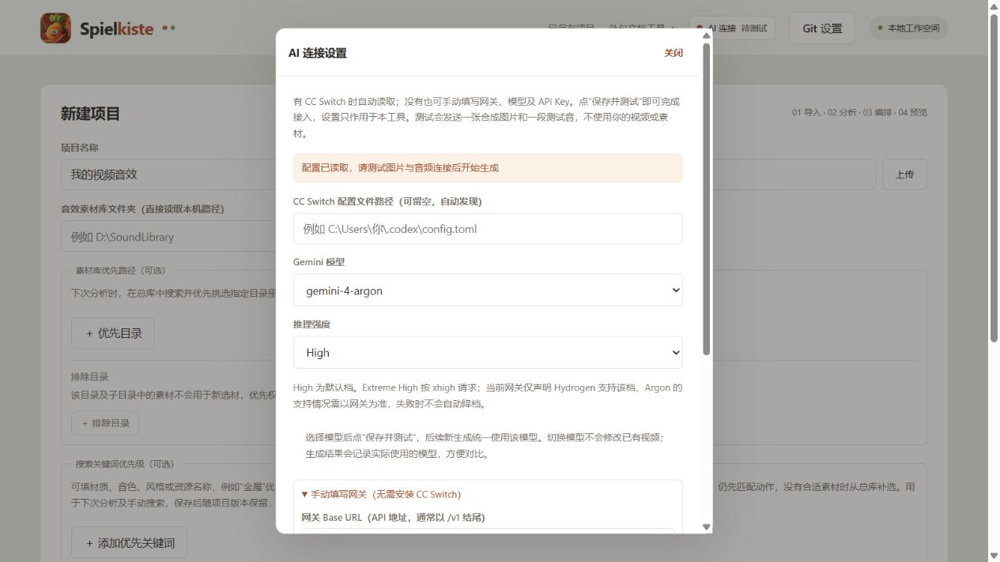
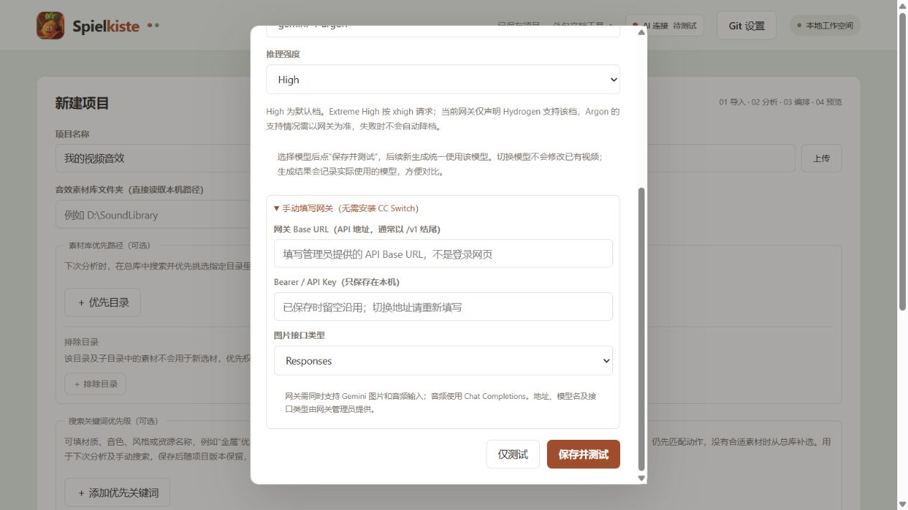
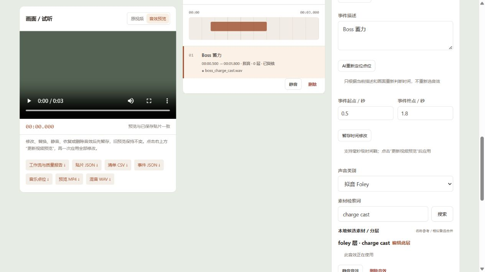
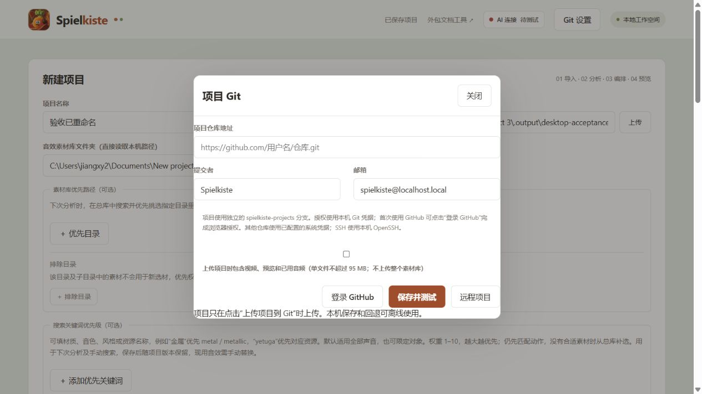

# Spielkiste 使用指南

从视频动作出发，在你指定的本地素材库中挑选声音，生成带音效的视频，再按需要修改、导出或分享。

第一次使用按第 1–4 节操作；之后可以直接打开“已保存项目”。截图来自当前实际界面。绿色画面与单条音效是操作演示素材，不代表 AI 成片效果；截图中的“待测试”表示尚未完成 AI 连接测试。

## 1. 安装与打开

1. 在 Windows 10/11 上双击 `Spielkiste-0.1.0-Setup.exe`，按提示选择安装位置并完成安装。
2. 从桌面快捷方式打开 **Spielkiste**。程序自动启动本机服务，无需另开启动脚本，也无需安装 Node、FFmpeg、FFprobe 或 Git。
3. 每次打开默认进入 **新建项目**。旧记录在“已保存项目”；新同事首次安装不会看到你的本机项目。
4. 准备一个视频、可访问的音效素材文件夹，以及可用的 Gemini 网关授权。只有需要转换 REAPER 工程中的音频格式时，才需要另外安装 REAPER。

安装包目前未签名，公司电脑如限制运行，请由 IT 按内部流程处理。使用免安装版时需保留整个目录，只复制 EXE 无法正常使用。

## 2. 首次连接 AI

点击右上角 **AI 连接**，按自己已有的授权选择一种接入方式。

### 已经配置 CC Switch

1. “CC Switch 配置文件路径”留空，让工具自动发现本机配置；没有识别到时，再填写实际配置文件路径。
2. 选择 `gemini-4-argon` 或 `gemini-4-hydrogen`，以公司网关实际可用型号为准。
3. “推理强度”首次建议选 **High**。需要对比时可选 **Extreme High**；它按 `xhigh` 请求，支持情况取决于模型及网关，失败不会自动降档。
4. 点击 **保存并测试**，等待图片与音频连接均成功，再关闭设置。

### 没有 CC Switch，使用公司提供的 API

1. 展开 **手动填写网关（无需安装 CC Switch）**。
2. 向管理员取得 **API Base URL、API Key、准确模型名、图片接口类型**。Base URL 是 API 地址，通常以 `/v1` 结尾，不要填网页登录首页。
3. 填入地址和 Key，按管理员提供的信息选择 **Responses** 或 **Chat Completions**，并选择模型与推理强度。
4. 点击 **保存并测试**。仅想检查填写内容可点“仅测试”；要供后续生成使用，仍需保存。

设置只作用于 Spielkiste，不会更改其他聊天窗口或全局 CC Switch 模型。Key 保存在本机，已保存时留空可沿用；切换地址需重新填写。连接测试使用合成图片与测试音，会产生少量模型调用。

正式生成时，视频抽帧及入选候选音频片段会发送到所配置的网关；素材库在本机读取，不会整库上传。网关必须同时支持图片和音频输入。

## 3. 指定视频与素材库

1. 填 **项目名称**，例如“Boss 技能音效测试”。
2. 点击视频一栏的 **上传** 选择文件，也可粘贴完整路径，如 `D:\Video\Boss.mp4`。
3. 点击 **选择本机文件夹**，进入目标音效目录并确认；也可粘贴路径，如 `D:\SoundLibrary`。工具直接读取目录，不需逐个上传音频。
4. 如需限定音乐来源，填 **背景音乐素材库**；留空则从上方素材库查找，并不表示关闭音乐。
5. 按需填写下方可选规则，滚动到表单底部，点 **分析并生成视频 ↗**。

网络目录需确保当前 Windows 账号可访问。先在资源管理器打开相同路径确认；生成时保持网络盘连接，不要移动正在使用的文件。

### 素材范围与偏好怎么填

| 设置 | 操作例子 | 效果 |
| --- | --- | --- |
| 优先目录 | 点“＋ 优先目录”，选 `D:\SoundLibrary\yetuga`，权重填 3 | 总库权重为 1，数值越大越优先；也能加入总库外的目录，不改变音量 |
| 排除目录 | 点“＋ 排除目录”，选不想使用的目录 | 该目录及子目录不参与新选材，音效和音乐均适用 |
| 优先关键词 | 点“＋ 添加优先关键词”，填“金属”或 `yetuga`，设权重；可限定对象 | 在匹配动作的基础上提高相关资源优先级，不会强行让所有点位使用它 |
| 禁用关键词 | 点“＋ 添加禁用关键词”，每行一个，如 `cartoon` | 文件名或路径包含该词就排除，忽略大小写，不扩展同义词 |

**排除优先于权重。** 优先目录若也被排除，其中素材仍不能选用。规则用于后续分析与搜索，不会自动替换已选声音；旧项目的现用素材需在编辑区手动替换。

## 4. 生成并试听

1. 点击 **分析并生成视频 ↗** 后查看页面状态。工具分析动作、UI、环境与音乐点位，检索名称与动作意图，复核候选，再按距离和主次混音。
2. 等待完成，在“画面 / 试听”点 **音效预览** 并播放；切换“原视频”可对照原画面和原音轨。
3. 重点听蓄力、出手、接触、吼叫、收势是否清楚；远景是否适当减弱，细节是否盖住关键动作，尾音是否自然。
4. 点击“声音事件”中的点位，右侧查看时间、当前素材及剪辑。可用“查看”筛选动作与 UI、音乐或环境。
5. 展开 **生成记录与质量检查**，查看实际分析、选材、混音和用量记录；待复核或回退提示需结合试听判断。

标准流程只使用指定素材库的声音，原视频音轨会静音；保留素材原速、原调，不额外添加混响。素材自身可能带音调变化或混响。自动检查通过仍需人工试听。

## 5. 修改音效并更新预览

**操作顺序：选点位 → 修改 → 点击“更新视频预览” → 试听新版本。** 可以连续修改多个点位，最后统一更新一次。

### 替换素材

1. 点中间的事件；多层音效时，先在右侧点对应层的 **编辑此层**。
2. 点击候选的 **试听**。备选不足时，在 **素材检索词** 输入动作、材质或资源名，如 `charge`、`cast`、`metal`、`yetuga`，再点 **搜索**。
3. 对合适候选点 **选用**。此时只暂存替换，旧预览仍播放旧声音。
4. 点右上方 **更新视频预览 ↗**，等待完成后再播放“音效预览”。普通编辑更新不会重新分析整段视频，也不会重新挑选其他已存声音。

### 静音或删除

- **静音整个点位**：关闭这个事件下的声音，可再次恢复，适合对比。
- **删除整个点位**：移除该事件及其贴片，可通过撤销暂存或历史版本找回。
- **静音这个音效 / 删除这个音效**：仅处理当前层，保留同一点位其他声音。
- **撤销暂存修改**：放弃尚未更新的编辑，恢复已保存内容。

这些操作都要点 **更新视频预览** 才会呈现在新视频里。提交或渲染失败时保留旧预览与暂存修改，查看报错后重试。

### 调整时间、音量和剪辑

| 参数 | 含义与用法 |
| --- | --- |
| 事件起点 / 终点 | 画面动作区间，单位秒；可填 `2.350`，修改后点“暂存时间修改” |
| 贴片起点 | 声音在视频中开始播放的时刻，单位秒 |
| 使用时长 | 实际播放多少秒；过短可能切掉吼叫或尾音 |
| 素材截取起点 | 从原音频第几秒开始取声音，与视频时间不同 |
| 增益 / dB | 声音大小；从 -6 改为 -12 会变轻 |
| 淡入 / 淡出 | 避免突然开始或断开；可从淡入 0.02 秒、淡出 0.10 秒开始试听调整 |

先判断声音与动作是否匹配，再调音量。关键预警与重击要突出，远景和零碎细节可降低。拉长时长受素材长度限制；循环适用于能持续播放的环境、音乐或持续声。

## 6. 让 AI 补上漏掉的动作

### 不知道准确时间，只描述画面内容

1. 在“声音事件”标题旁点 **＋ 添加事件**，展开 **描述补声**。
2. 输入确实出现的动作，如“猩猩啃咬角色，咬合接触时需要冲击声”，无需填写时间。
3. 点 **Gemini 查找动作并添加音效**。工具查找该动作、定位时间、匹配本地素材并生成新预览。
4. 完成后试听新增点位，必要时再调整。描述尽量包含对象和动作。

### 已有声音合适，但时间不准

选事件，在右侧完善 **事件描述**，点 **AI重新定位点位**。它重新判断时间、保留已选素材。如果知道准确时间，可直接填写起止秒数，点“暂存时间修改”，再更新预览。

明确发起的 AI 补声或重新定位会调用模型并创建新版本。有暂存修改时先更新预览，再发起 AI 操作。只想手动加点，可在描述补声中点 **手动填写时间**；音乐可用 **＋ 音乐点位** 添加。

## 7. 保存、重命名与历史回退

生成完成及提交编辑后，项目自动保存在本机。“已保存项目”中每个项目只显示一条，修改历史放在项目内部。

1. **继续编辑**：在“已保存项目”选择记录；刚生成的记录未出现可点“刷新”。
2. **修改名称**：点项目标题下的 **重命名**。
3. **保留不同方案**：点 **另存为新项目**，给副本命名后分别编辑。
4. **查看旧版**：在“版本”选择记录，点 **打开历史版本**，先试听。
5. **恢复旧版**：确认后点 **回退到此版本**。历史仍保留；可用“返回修改前版本”快速对照前一版。
6. **固定认可的声音**：点 **保留本版音效**。之后相同视频、素材库及相关选材规则匹配时优先复用，避免无意换掉已认可素材。

暂存编辑不等于一个正式视频版本。交付前应更新并确认“预览与已保存贴片一致”。本机历史查看与回退不需上传 Git；重新 AI 分析仍需网络。

## 8. 导出成片与 REAPER 工程

### 视频与清单

先更新预览并试听，在播放器下方点 **预览 MP4 ↓**、**混音 WAV ↓**、**贴片 JSON ↓** 或 **清单 CSV ↓**。MP4 用来看成片，WAV 用于整体音频，JSON / CSV 用于核对点位和素材；清单本身不包含媒体文件。

### 可继续编辑的 REAPER 工程

1. 点项目右上方 **导出 Reaper 工程 ↗**。
2. 按交付要求选择格式、采样率和声道。无需统一规格时全部保留；团队交付可按约定选 **WAV 24 位 PCM / 48 kHz**。
3. 输入工程名即可，自动补 `.rpp`；留空使用项目名，也可填完整目标路径。
4. 点 **导出工程** 并等待。格式、采样率或声道转换使用本机 REAPER，请先确认已安装。
5. 根据完成提示找到目录，打开 `.rpp`。视频独立一轨，音效逐条分轨，并按对象和声音类型建立文件夹轨道与颜色分组。
6. 分享时压缩 **整个工程文件夹**，包括 `.rpp`、`Audio` 和 `Video`。工程使用相对资源路径，可整体移动，不要只发 `.rpp`。

| 设置 | 怎么选 |
| --- | --- |
| 保留原文件 / 原采样率 / 原声道 | 不要求统一规格时使用；若仍需转换，“保留原文件”会使用 WAV 64 位浮点 |
| WAV 24 位 PCM | 常用制作与交付格式，按团队要求选择 |
| WAV 32 / 64 位浮点 | 需要浮点文件时使用，体积较大，不会恢复源素材原本没有的细节 |
| 全部单声道 | 合并左右声道，可能改变空间感或发生相位抵消，需试听 |
| 统一双声道 | 转换文件，不复制轨道；单声道来源不会因此自动获得立体空间感 |
| Dither / Noise Shaping | 用于之后在 REAPER 的最终 Master 渲染，不是素材转换开关；一般保留默认，16 位 PCM 自动开启 Dither，Noise Shaping 按交付要求决定 |

工程保留贴片时间、源区间、音量和淡入淡出。原素材放在 `Audio/Originals`，转换文件在 `Audio/Converted`。声道与采样率转换可能影响听感，不能把任意转换都理解为完全无损。

## 9. 手动通过 Git 分享项目

不需要分享时可跳过。本机保存、编辑和回退不会自动上传项目。

1. 准备一个有写权限的仓库，复制 **具体仓库地址**，如 `https://github.com/团队名/项目仓库.git`；GitHub dashboard 首页不能用于上传。
2. 打开右上角 **Git 设置**，填写项目仓库地址、提交者和邮箱。
3. GitHub 用户点 **登录 GitHub**，在浏览器完成授权，再回来点 **保存并测试**。其他公司 Git 服务使用本机已配置凭据，SSH 需要本机 OpenSSH。
4. 想让同事直接播放，勾选 **上传项目时包含视频、预览和已用音频**；仅传清单时，对方仍需另行取得媒体。
5. 关闭设置，打开要分享的项目，确认最新预览后点 **手动上传项目到 Git**，等待成功提示。
6. 同事安装工具、配置自己的 AI 连接及同一仓库授权，在 **Git 设置 → 远程项目** 中点 **下载到本机**，再从“已保存项目”打开。

包含媒体只打包已用文件，不上传整个素材库。单文件上限按 **95 MB** 处理；大视频可先制作较小测试副本，或只传清单并另外分享媒体。下载不会自动覆盖相同 ID 的本机项目；需要独立副本时先另存为新项目。接收者继续搜索新声音时，仍需指定自己可访问的素材库。

## 10. 更新、备份与常见问题

### 更新与备份

- **更新工具**：安装新版本安装包，本机项目数据会保留。
- **项目数据**：在资源管理器地址栏输入 `%APPDATA%\Spielkiste\workspace`；完整备份前先关闭工具。
- **外部素材**：本机项目可能引用外部视频和音效库。备份时一并保留原文件与路径，仅备份记录不等于备齐媒体。
- **AI 授权**：位于 `%LOCALAPPDATA%\Spielkiste`，属于个人配置，不随项目分享。不要把 Key 写进仓库地址或截图。
- **卸载**：默认保留项目数据。换电脑可用手动 Git 分享或完整备份迁移。

### 常见问题

| 现象 | 处理方法 |
| --- | --- |
| AI 待测试或失败 | 打开 AI 连接并保存测试，检查 API 地址、Key、模型和接口类型，确认同时支持图片和音频 |
| Extreme High 报错 | 网关可能不支持该模型的 xhigh，选 High 后重新保存测试 |
| 文件夹选择无反应 | 直接粘贴完整目录，在资源管理器确认可访问；网络盘先检查账号与连接 |
| 分析很久或失败 | 查看状态与生成记录，先用短视频及具体素材子目录测试，确认网关在线，避免重复提交 |
| 替换后仍是旧声音 | 点击更新视频预览，完成后切到音效预览；试听候选不等于应用到成片 |
| 视频或音频找不到 | 检查原文件是否移动、删除或网络盘断开；分享 REAPER 要带整个目录 |
| 已保存项目未出现 | 点刷新，确认同一 Windows 账号和数据目录；其他电脑需要手动下载共享项目 |
| REAPER 转换失败 | 确认 REAPER 已安装、输出目录可写，先用全部保留设置排查 |
| FFprobe 被拒绝 / EPERM | 关闭旧服务与重复实例，从桌面打开安装版重试；仍失败时提供日志检查运行限制 |
| Git 上传失败 | 检查仓库地址、写权限和网络，重新登录，确认单文件不超过 95 MB |

反馈时提供操作步骤、报错文字和必要截图。启动日志位于 `%APPDATA%\Spielkiste\desktop.log`；发送前检查并去除授权信息。
